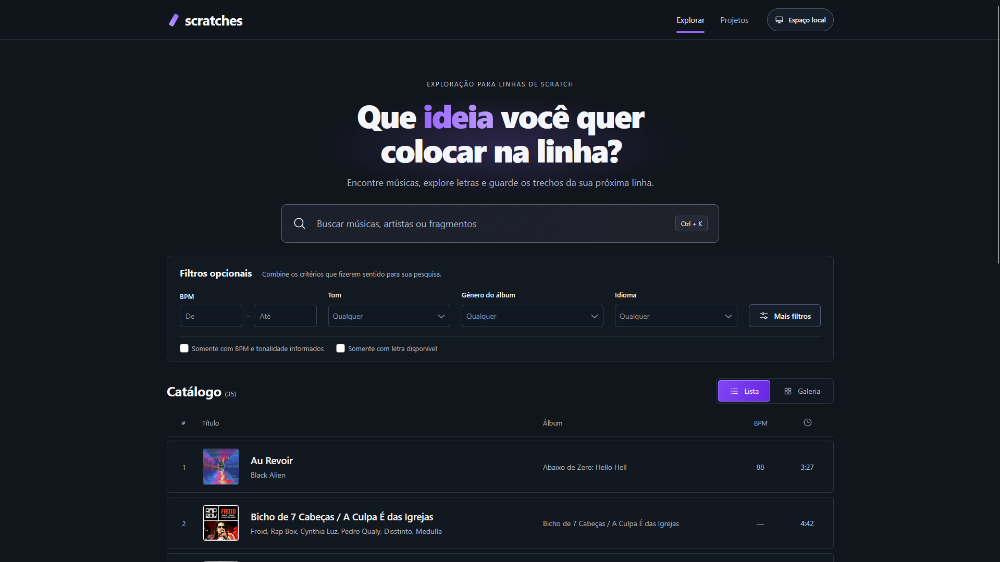

# Scratches

**Pesquisa para suas linhas de scratch.**

O Scratches é uma ferramenta para DJs reunirem ideias para suas linhas: explorar músicas e letras, escolher palavras ou versos e organizar esses trechos em projetos. Ele roda no seu computador e você usa a interface pelo navegador, sem criar conta.

## Preview



*Captura da interface com o catálogo usado no desenvolvimento. O download público começa com o catálogo vazio.*

> **Sobre a versão 0.1.0:** o projeto ainda está em desenvolvimento. O download começa sem músicas, artistas, capas, letras ou projetos. Você já pode criar projetos e guardar backups, mas a inclusão de músicas e a conexão com catálogos ainda não estão disponíveis. Por isso, a pesquisa e a seleção de trechos ainda dependem de um catálogo fornecido separadamente.

[**Baixar Scratches 0.1.0 para Windows ou macOS**](https://github.com/gpradotech/scratches/releases/download/v0.1.0/scratches-0.1.0.zip) · [Ver as versões publicadas](https://github.com/gpradotech/scratches/releases)

## Antes de começar

Você precisa de um computador e do **Node.js 22.19 ou superior**, um programa gratuito que permite abrir o Scratches. Não precisa saber programar, instalar Git ou criar uma conta no GitHub.

A internet é necessária para baixar o Scratches e o Node.js, consultar e baixar atualizações e enviar feedback. Seus projetos e backups ficam no computador.

O Windows foi testado. As instruções para macOS estão disponíveis abaixo, mas a execução ainda não foi validada em um Mac real.

## Baixar e preparar

1. [Baixe o arquivo `scratches-0.1.0.zip`](https://github.com/gpradotech/scratches/releases/download/v0.1.0/scratches-0.1.0.zip).
2. **Extraia todo o ZIP** para uma pasta fácil de encontrar, como `Documentos/Scratches`. No Windows, clique com o botão direito no ZIP e escolha **Extrair Tudo**. Abra a pasta extraída até encontrar `iniciar-prototipo.cmd` e `start.command`.
3. [Baixe e instale o Node.js](https://nodejs.org/), escolhendo uma versão LTS igual ou superior a 22.19 para seu sistema. Se ele já estiver instalado nessa versão ou em uma mais recente, pule esta etapa.

**Use o ZIP do link acima.** Na página de versões do GitHub, escolha `scratches-0.1.0.zip`. Os itens chamados **Source code** e a opção **Code → Download ZIP** são destinados a quem desenvolve o projeto e exigem preparação adicional.

O ZIP pronto já contém os arquivos necessários do Scratches. Depois de instalar o Node.js, você não precisa instalar outros componentes nem executar comandos de instalação.

## Instalar no Windows

1. Abra a pasta que você extraiu. **Não abra o aplicativo de dentro do ZIP.**
2. Dê dois cliques em **`iniciar-prototipo.cmd`**. Apesar do nome, esse é o arquivo que abre o Scratches.
3. Uma janela de terminal será aberta, com uma mensagem informando que o Scratches está disponível. **Deixe essa janela aberta durante o uso.**
4. Abra seu navegador e acesse **[http://127.0.0.1:5174](http://127.0.0.1:5174)**.

Esse endereço abre a aplicação que está rodando no seu próprio computador. A página do GitHub serve para baixar o projeto e ler as instruções.

Para encerrar, volte à janela do terminal e pressione **Ctrl+C**. Se o Windows pedir confirmação para encerrar o arquivo em lotes, confirme. Na próxima vez, basta abrir `iniciar-prototipo.cmd` e acessar o mesmo endereço.

## Instalar no macOS

1. Abra o aplicativo **Terminal**.
2. Digite `cd ` — com um espaço depois de `cd` —, arraste a pasta extraída do Scratches para essa janela e pressione **Enter**.
3. Copie o comando abaixo, cole no Terminal e pressione **Enter**:

```sh
sh start.command
```

4. Deixe o Terminal aberto e acesse **[http://127.0.0.1:5174](http://127.0.0.1:5174)** no navegador.

Para encerrar, pressione **Ctrl+C** no Terminal. Para abrir novamente, repita os passos 2 a 4. A execução em um Mac real ainda precisa de validação.

## Primeiro uso

Ao abrir o Scratches pela primeira vez, você verá **Seu catálogo está vazio**. Isso é esperado: os dados usados nos testes de desenvolvimento não acompanham o download.

Você já pode experimentar a organização de projetos:

1. Clique em **Projetos**, no topo da página.
2. Clique em **Novo projeto** ou **Criar projeto**.
3. Dê um nome à sua linha de scratch e clique em **Criar projeto**.
4. Abra **Espaço local** para conferir seus dados e exportar uma cópia de segurança.

As alterações são salvas automaticamente. Fechar o navegador ou encerrar o aplicativo não apaga seus projetos. Para continuar depois, abra o Scratches a partir da **mesma pasta**.

### E a pesquisa de músicas e letras?

A versão atual ainda não oferece uma forma de cadastrar músicas pela interface nem de buscar músicas automaticamente no Spotify ou em outro serviço. Alterar os filtros não preenche o catálogo vazio.

Quando há um catálogo disponível na instalação, a interface permite pesquisar músicas e artistas, adicionar uma letra por arquivo `.txt` ou colando o texto, selecionar trechos e guardá-los em projetos. A pesquisa de palavras e frases usa as letras adicionadas nesse computador.

A inclusão de catálogo faz parte das próximas etapas do projeto. Esta versão não baixa músicas, reproduz ou edita áudio, nem faz pesquisa por significado com inteligência artificial.

## Guardar e recuperar seus projetos

Use **Espaço local**, no topo da aplicação:

- **Exportar backup:** baixa um arquivo com seus projetos, letras adicionadas e trechos salvos. Guarde uma cópia em outro lugar, como um pendrive ou uma pasta de backup.
- **Importar backup:** permite escolher um arquivo exportado pelo Scratches. Confira o conteúdo apresentado antes de confirmar em **Substituir pelo backup**.

**Restaurar um backup substitui os dados atuais.** Exporte uma cópia do seu espaço antes, se quiser preservá-lo. O backup não inclui o catálogo de músicas ou as capas.

Mantenha a pasta do Scratches: ela também guarda seus dados. Eles ficam em `dados/prototipo-02/workspace.json`; você não precisa abrir nem editar esse arquivo. Não há sincronização automática entre computadores.

## Atualizar o Scratches

1. Com a aplicação aberta, clique em **Verificar atualizações**, no rodapé.
2. Quando houver uma nova versão, confira as novidades e escolha **Atualizar e reiniciar** ou **Mais tarde**.
3. Se você confirmar, aguarde a conclusão. A aplicação espera salvamentos e trabalho pendente antes de reiniciar; siga as orientações que aparecerem na tela.

A atualização preserva seus projetos, letras e catálogo local. Mesmo assim, mantenha um backup exportado. Se a nova versão não conseguir iniciar, o aplicativo tenta restaurar a versão anterior e seus dados.

Apenas atualizar a página do navegador não instala uma nova versão. [Mais informações sobre as atualizações](docs/ATUALIZACOES.md).

## Se algo não funcionar

| O que aconteceu | O que fazer |
| --- | --- |
| Aparece uma mensagem dizendo que falta Node.js | Instale o [Node.js](https://nodejs.org/) 22.19 ou superior, feche a janela do Scratches e abra o inicializador novamente. |
| Não encontro o arquivo para abrir | Extraia o ZIP inteiro e abra a pasta que contém `iniciar-prototipo.cmd` e `start.command`. No Windows, a extensão pode estar oculta e o nome aparecer apenas como `iniciar-prototipo`. |
| O navegador não abriu sozinho | Abra-o e digite `http://127.0.0.1:5174` na barra de endereços. |
| O endereço não abre ou parou de funcionar | Confira se a janela do terminal continua aberta. Se você a fechou, abra o Scratches novamente pelo inicializador. |
| Aparece uma mensagem de porta ocupada | Pode haver outra janela do Scratches em execução. Use a instância já aberta ou encerre-a antes de tentar novamente. Não apague seus dados para resolver isso. |
| Não aparece nenhuma música | O download desta versão vem com catálogo vazio. A inclusão de músicas ainda está em desenvolvimento; isso não indica erro de instalação. |
| Não consigo salvar | Use uma pasta em que sua conta possa gravar arquivos, como uma pasta própria em Documentos. Se já tiver dados, preserve a pasta inteira e seus backups ao transferi-la. |
| Meus projetos não aparecem depois de abrir outra cópia | Cada pasta do Scratches tem seus próprios dados. Abra a instalação anterior ou importe um backup exportado dela. |
| A atualização ou o feedback falhou | Confira a conexão com a internet e tente novamente mais tarde. Seus projetos continuam salvos localmente. |

## Problemas e sugestões

Clique em **Enviar feedback**, no rodapé, e conte o que aconteceu, os passos que você seguiu e o resultado esperado. Para sugestões, explique o que gostaria de fazer.

O endereço de e-mail para resposta é opcional. O formulário envia somente os campos preenchidos; seus projetos, letras e arquivos não são anexados. Se o envio falhar, a mensagem permanece no formulário para você tentar novamente.

Se preferir e já tiver conta no GitHub, [registre um problema ou uma sugestão](https://github.com/gpradotech/scratches/issues).

<details>
<summary>Informações para quem desenvolve o projeto</summary>

O código disponível neste repositório contém os arquivos revisados para distribuição. Pesquisa, planejamento interno, referências visuais, credenciais e dados pessoais de desenvolvimento ficam fora dele.

A aplicação fica em `app/`, na raiz. O ZIP da versão 0.1.0 conserva a estrutura com que foi publicado; as instruções de instalação acima correspondem a esse download. A mudança de pasta está no código atual e será incorporada a uma próxima distribuição após a validação da atualização de instalações anteriores.

Para preparar o código-fonte:

```sh
npm ci
npm run build
npm run check
npm test
npm run dev
```

O desenvolvimento usa http://127.0.0.1:5174. Execute uma instância por porta. Sem corpus local, a preparação inicia um catálogo vazio e preserva um catálogo já existente.

`npm run build:release` gera o ZIP e o pacote de atualização a partir dos mesmos arquivos validados, com hashes SHA-256. Consulte [o processo de publicação](docs/ATUALIZACOES.md).

</details>
